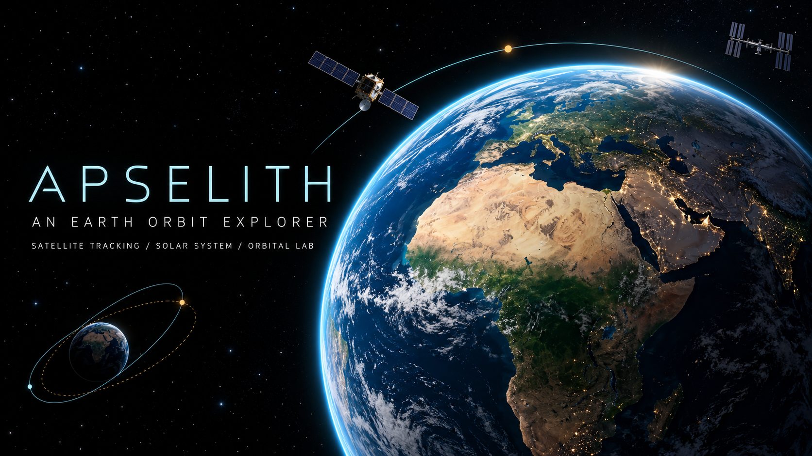

<p align="center">
  
</p>

# APSELITH

A browser-based satellite explorer and two-body orbital laboratory. Uses published CelesTrak elements and satellite.js SGP4 predictions, with a Cesium Earth view. No account, API key, custom backend, or database server is required.



_Designed project artwork; illustrative composition and scale._

Built by [Ahmed Marey](https://ahmed-mar3y.space). [Help support Gaza relief through PCRF](https://www.pcrf.net/).

## Run locally

Use Node.js 24 LTS and npm 11.

```sh
npm ci
npm run dev
```

Open http://127.0.0.1:5173. The predev/prebuild scripts copy Cesium's installed static assets into the ignored `public/cesium` directory. There are no required environment variables or Cesium ion credentials. A detailed NASA Blue Marble texture is served locally, with Cesium's Natural Earth imagery as a fallback. See [image attribution](public/assets/ATTRIBUTION.md).

## Features

- Validated Space stations, Starlink, operational GPS, Galileo and weather catalogs; search by name/NORAD ID, selection and local favorites.
- SGP4 predicted position, speed, element epoch and freshness.
- Large interactive Earth against a black interface, detailed NASA imagery, optional day/night lighting, selected trajectory and ground track, focus/follow, overview and polar cameras.
- Automatic satellite centering/follow, full-window Focus with Exit/Escape, and independently scrollable details.
- Tycho star-map background, modeled Sun/Moon, ephemeris-based planet symbols, and an interactive Solar System view.
- Shared UTC clock with pause, speed, time jumps, stepping and real-time reset.
- Worker-based propagation, selected trajectory sampling and geometric pass calculation.
- Manual observer coordinates, presets and explicitly requested geolocation.
- Elliptical two-body laboratory with input validation, Kepler motion, perigee/apogee, energy and speed.
- IndexedDB cache and an explicitly dated catalog snapshot when the provider is unavailable.

## Commands

```sh
npm run typecheck
npm run lint
npm run format:check
npm test
npx playwright install chromium
npm run test:e2e
npm run build
npm run preview
```

Normal tests use the checked-in catalog and do not query CelesTrak. Browser tests intercept the provider and fix UTC time. GitHub Actions runs formatting, lint, types, unit/integration tests, production build and Chromium tests.

## Stack and boundaries

React, Vite, strict TypeScript, React Router, Zustand, TanStack Query, Tailwind CSS, Lucide, CesiumJS, satellite.js, Zod and idb. See the [feature and implementation report](docs/features-and-implementation.md), [architecture](docs/architecture/overview.md), [decisions](docs/decisions/001-foundation.md), [scientific model](docs/scientific-models.md), [performance](docs/performance.md) and [implementation status](docs/status.md).

Repository description, suggested topics and portfolio copy are available in the [project presentation kit](docs/project-presentation.md).

## Data and privacy

Use the Satellite group selector for CelesTrak's `stations`, `starlink`, `gps-ops`, `galileo` and `weather` groups. Groups load on demand with independent caches and request throttles. The stations group can include attached modules, visiting vehicles and other provider-selected objects; membership does not imply all objects are crewed stations. No extra metadata is inferred. Source: [CelesTrak GP JSON](https://celestrak.org/NORAD/elements/gp.php?GROUP=stations&FORMAT=json).

Full catalogs are searchable. The globe displays up to 150 matches, including the selected object, and the list loads 60 rows at a time. Search narrows which objects appear. GPS and Galileo trajectories can be viewed over windows up to 24 hours. The render limit is a responsiveness guardrail, not a capacity benchmark.

At most one provider attempt per group per two hours is made per browser profile under normal use, including failed requests. IndexedDB stores the catalog; localStorage stores favorite IDs and the request timestamp. The provider sees the normal fetch request, but observer coordinates are used only locally. Browser geolocation is requested only by its button. Clearing site storage removes these preferences and data. Cache writes that fail produce visible degraded-state messages.

The bundled fallback was fetched on **2026-10-19 at 22:49:16 UTC**. Its timestamp and element epochs remain visible. Replace it with a newly validated snapshot for future releases; it is not a permanent live feed.

## Scientific limitations

Educational exploration only. These are calculated predictions, not measurements or certified navigation. SGP4 element age matters, especially after maneuvers. Predictions outside ±14 days of an element epoch are rejected; this is a product guardrail, not an accuracy guarantee. Elements older than 72 hours are marked stale. Pass results are geometric only and exclude passes already underway or unfinished at the end of the search window. They do not predict visual visibility.

The laboratory assumes point-mass gravity and omits drag, oblateness and other perturbations. Its views are a true orbit-plane diagram or an equatorial orthographic projection, not an operational inertial reference-frame viewer.

## Deploy

Import this repository into Vercel with the Vite preset, Node 24, build command `npm run build`, and output `dist`. `vercel.json` supplies SPA route fallback. Keep `data`, `assets` and `cesium` URLs as static files. No deployment has been performed by this implementation session.

## Current scope

The first usable vertical slice is implemented. Catalog expansion, independent pass-timing reference validation, representative GPU performance profiling and further mobile/accessibility hardening remain tracked in [status](docs/status.md). Do not interpret passing tests as completion of every requirement in the master specification.
